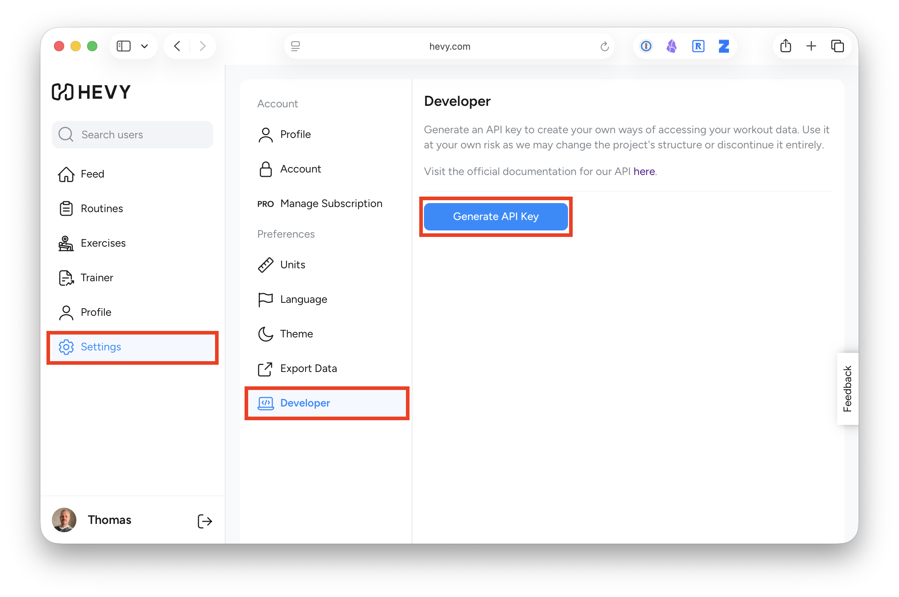
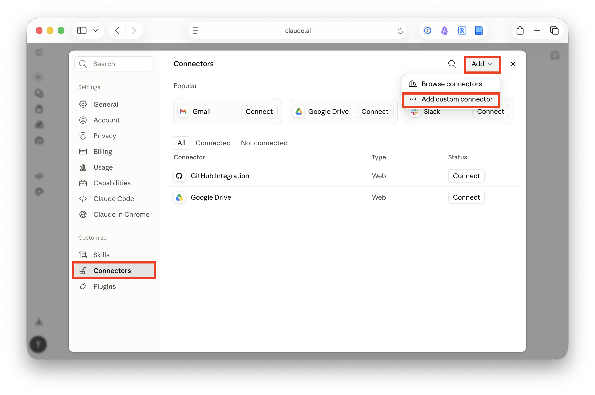
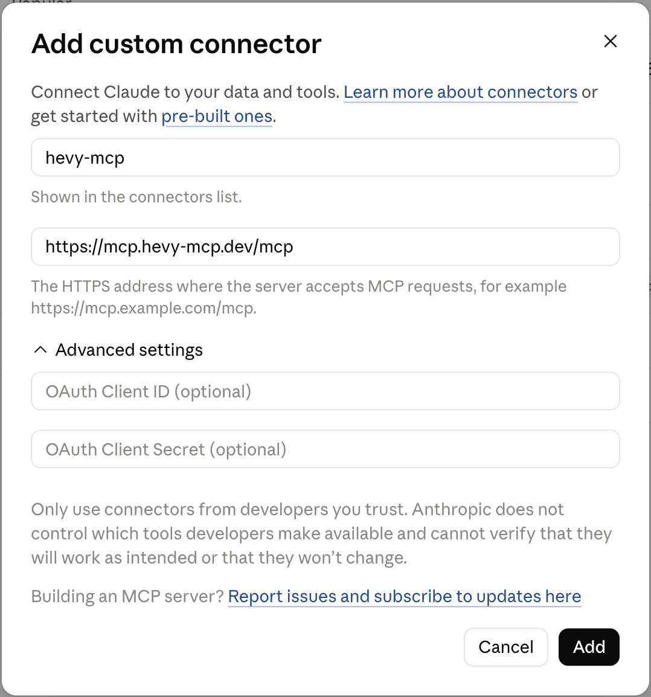
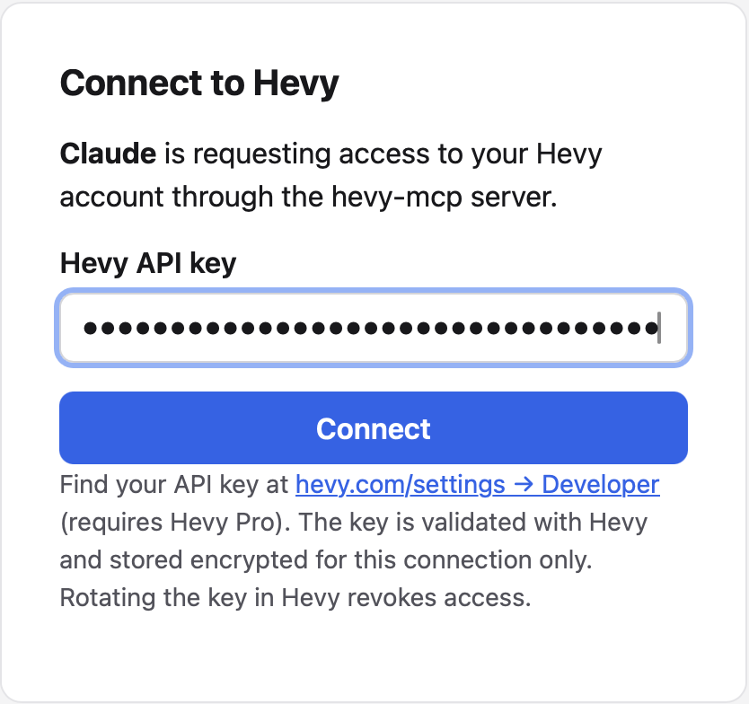
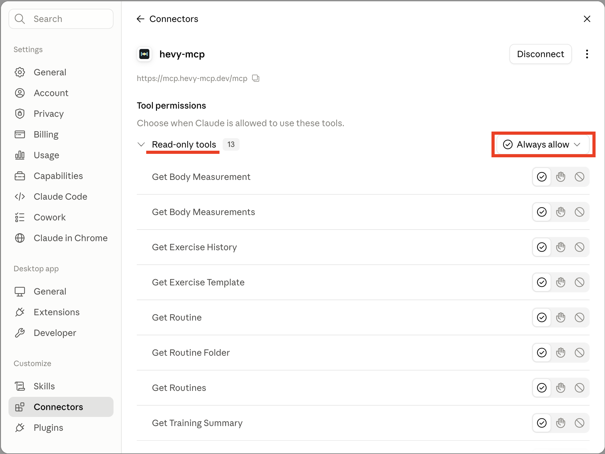
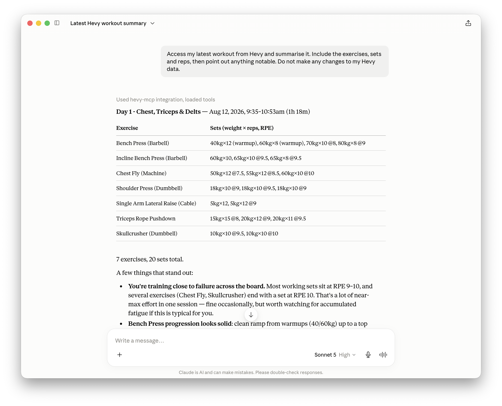

Want Claude to be your personal trainer, monitor your gym progress and make programs for you? 

In this guide, we'll connect the [Hevy workout tracker](https://www.hevyapp.com/) to [Claude](https://claude.ai/). Once it is set up, you can ask questions such as:

> Summarise my latest workout. What went well, and what should I pay attention to next time?

There is no coding, command line or software installation involved. The whole setup should only take a few minutes.


## What are we connecting?

Hevy already holds your workout data. Claude can reason about that data, but it needs a safe way to request it. Two pieces make the connection possible:

- An **API key** is a secret pass that allows another service to access your Hevy account.
- **MCP** (Model Context Protocol) is a standard that lets AI assistants use external tools. You can think of it as a universal adapter between Claude and Hevy.

We'll use the open-source [`hevy-mcp` project](https://github.com/chrisdoc/hevy-mcp) as that adapter:

**Claude → hevy-mcp → Hevy**

## What you'll need

Before you begin, make sure you have:

- A Hevy account with [**Hevy Pro**](https://help.hevyapp.com/hc/en-us/articles/35119778922263-Hevy-Pro-Subscription-How-to-get-Pro-and-What-Does-It-Include). [API access currently requires Pro](https://github.com/chrisdoc/hevy-mcp#1-get-your-hevy-api-key), whether you pay monthly, yearly or have lifetime access.
- A [Claude](https://claude.ai/) account. [Free accounts can currently add one custom connector](https://support.claude.com/en/articles/11175166-get-started-with-custom-connectors-using-remote-mcp); paid accounts can add more.
- A few minutes and a web browser. The same remote connector also works in Claude Desktop.


## 1. Find the Hevy MCP server address

We're going to use this open source [`hevy-mcp`](https://github.com/chrisdoc/hevy-mcp) project. On this page, we can find the MCP server address under the **Claude integration** section, which is: 

```text
https://mcp.hevy-mcp.dev/mcp
```

We will paste it into Claude shortly.


## 2. Generate your Hevy API key

Go to [hevy.com](https://hevy.com/) and sign in. Open **Settings**, choose **Developer**, then generate a new API key. Again, you'll need a Hevy Pro subscription to do this currently.



Copy the key and keep it somewhere private for the next few steps. 

> **A quick security note:** Treat your Hevy API key like a password. Do not share it, paste it into a normal chat, or include it in a screenshot or video. This tutorial uses a community-maintained connector rather than an official Hevy service. Review the project's [source code](https://github.com/chrisdoc/hevy-mcp) and [privacy policy](https://github.com/chrisdoc/hevy-mcp/blob/main/docs/privacy-policy.md) before deciding whether you trust it with your workout data.


## 3. Add the connector to Claude

In [Claude](https://claude.ai/) (web or desktop app), open **Settings**, then choose **Connectors**.

Click the **Add** menu in the top-right corner and choose **Add custom connector**.



Give the connector a name, for example `hevy-mcp`, then paste the MCP server address from above into the **MCP server URL** field, and leave the optional advanced fields blank. Then click **Add**.



## 4. Connect your Hevy account

Find the new Hevy connector and click **Connect**. Claude will open an authorisation flow in your browser.

When the Hevy MCP page asks for your API key, paste the key you generated earlier and continue. Enter it only on the connector's authorisation page—not in a Claude conversation.



## 5. Choose what Claude may do automatically

The connector gives Claude several tools. Some only read your data; others can create or change information in Hevy.

A sensible starting point is:

- Allow **read-only tools** without asking every time. These retrieve workouts, routines, exercises and training summaries.
- Require confirmation for **create or update tools**. These can change data in your Hevy account.
- Disable any tools you do not plan to use.

You can review the available tools from Claude's connector or tools menu. Avoid choosing **Allow always** for every tool simply to make the prompts disappear. A little friction before an AI changes your data is a useful safety feature.




## 6. Try your first workout question

Start a **new chat** in Claude and make sure the Hevy connector is enabled for that conversation. Then ask:

> Access my latest workout from Hevy and summarise it. Include the exercises, sets and reps, then point out anything notable. Do not make any changes to my Hevy data.

Claude should call the Hevy tools, retrieve your most recent session and produce a summary based on your real workout data.




## Where to go next

Once the basic connection works, try questions that compare more of your history:

- “Give me a training summary for the last four weeks.”
- “Compare my last three leg workouts. Am I adding weight or reps?”
- “Which exercises have I trained most consistently this month?”
- “Find my recent squat sessions and summarise my progress.”


## Troubleshooting

**I cannot see the custom connector option.**  
Check that you are looking under **Settings/Customize → Connectors**. On Team or Enterprise accounts, an organisation owner may need to add the connector first.

**Claude connected, but cannot see my workouts.**  
Make sure the Hevy connector is enabled in the new conversation. If it still fails, disconnect it, confirm that your Hevy Pro access and API key are active, then connect again.

**Claude keeps asking for permission.**  
That is expected for tools that create or update data. For trusted read-only tools, you can choose **Allow always** when prompted or adjust their permission in the tools menu.

**I accidentally exposed my API key.**  
Revoke the key in **Hevy → Settings → Developer**, generate a replacement, and reconnect the connector. Do not continue using the exposed key.

That's it: Claude can now work with your actual Hevy history, while you remain in control of which tools it may use. 


